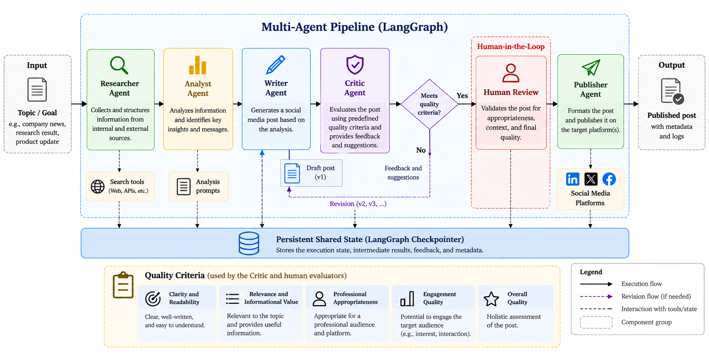
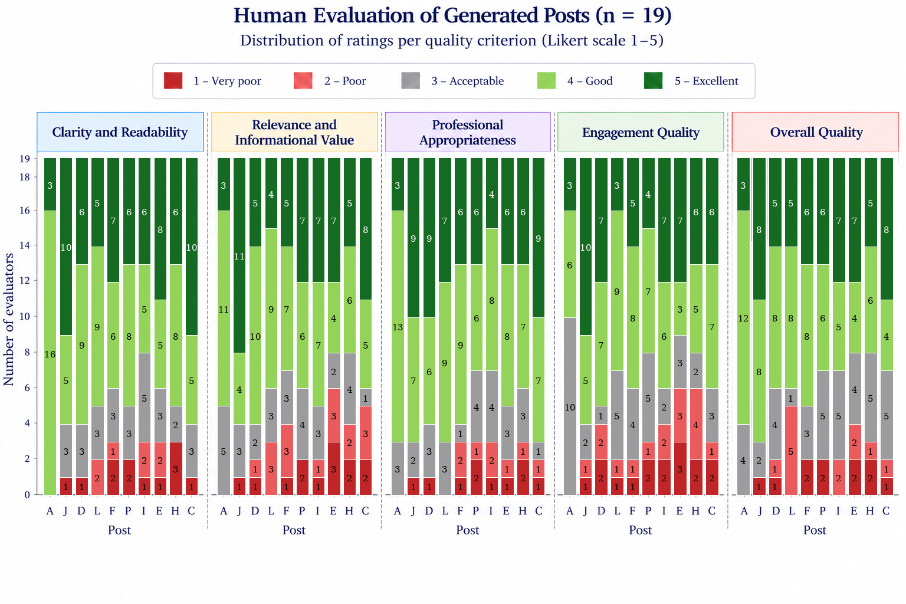

# Solera: Human-in-the-Loop Multi-Agent Content Generation

Code, data, and figures accompanying **A Human-in-the-Loop Multi-Agent Architecture for Social Media Content Generation** (ICAART 2027).

Solera writes professional LinkedIn posts with five agents: Researcher, Analyst, Writer, Critic, and Publisher. A stateful LangGraph workflow coordinates them. An LLM-based Critic scores each draft on a four-dimension rubric, an acceptance rule computed in code decides whether the draft is rewritten or forwarded, and a human reviewer approves every post before publication.

The study compares the Critic with 19 human evaluators on ten generated posts. The Critic's scores were close to the mean human ratings but nearly constant across posts, so its exact agreement with individual evaluators (30.9%) did not exceed the level expected from the score distributions (31.2%). The Critic was stable across repeated runs and rejected 80% of truncated posts. A revision of its prompt alone changed 9 of the 10 acceptance decisions.

The figures and tables that do not fit in the paper are reproduced below, each with a description. The sections link to the prompts, data, and scripts behind the results.

## Architecture

The Researcher collects sources through web search (Tavily), the Analyst extracts the main insights, the Writer drafts the post, and the Critic scores it and suggests revisions. The agents are nodes of a LangGraph `StateGraph` and do not call one another: each node reads the shared state and returns a partial update, and conditional edges decide where execution goes next. The Critic never decides whether a post is accepted; that decision is computed in code. A rejected draft returns to the Writer for at most three automatic rewrites. A draft that passes, or exhausts its rewrites, waits for the human reviewer. While it waits, the workflow is suspended with `interrupt()` and its state is persisted, so the run resumes from the same point.

**Paper Figure 1: Multi-agent pipeline with Critic-based quality control, iterative revision, and Human-in-the-Loop validation before publication.**

Solid arrows are the execution flow. The dashed purple arrow is the revision loop between the Critic and the Writer, and the dashed black lines are interactions with tools and with the persistent shared state (the LangGraph checkpointer). The band at the bottom lists the quality criteria used by both the Critic and the human evaluators.

| Agent | Role | Model in the study | Temperature | Prompt |
|---|---|---|---:|---|
| Researcher | Searches recent sources on the topic | GPT-4o | 0.3 | [prompt](prompts/en/01-researcher.md) |
| Analyst | Filters the sources and extracts 3 to 5 insights | GPT-4o | 0.3 | [prompt](prompts/en/02-analyst.md) |
| Writer | Writes the post and the requested rewrites | GPT-4o / GPT-4o-mini | 0.9 | [prompt](prompts/en/03-writer.md) |
| Critic | Scores the post and lists what to improve | GPT-4.1 | 0.1 | [prompt](prompts/en/04-critic.md) |
| Human reviewer | Approves, requests changes, or cancels | | | |
| Publisher | Publishes the approved post on LinkedIn | | | |

The prompts ran in Brazilian Portuguese. The [originals](prompts/README.md) and their [English translations](prompts/en/README.md) are generated from the system itself. In the code and the interface, the Critic is called **Judge**.

## Critic rubric and acceptance rule

The Critic and the human evaluators rate the same four dimensions on a 1 to 5 scale. The paper's Table 1 shows only the evaluation questions; the full rubric, with a verbal anchor for every scale point, is below (translated from Brazilian Portuguese; [original](prompts/05-rubrica-e-regra-de-aceitacao.md)).

**Table - Clarity and Readability (Cla, weight 0.35).** *Is the post clear, understandable, well structured and easy to read?*

| Score | Anchor |
|---|---|
| 1 Very poor | Confusing; dense block or overly long sentences, with no identifiable central idea. |
| 2 Poor | Hard to follow; weak structure and requires re-reading; the idea appears only at the end or not at all. |
| 3 Acceptable | Understandable with average effort; acceptable structure, but some passages are dense, truncated, or repetitive. |
| 4 Good | Clear and well organized; fluent reading, central idea evident early, and line breaks support readability. |
| 5 Excellent | Exceptionally clear; each paragraph advances the idea, rhythm and formatting serve the reader, and nothing is superfluous. |

**Table - Relevance and Informational Value (Rel, weight 0.35).** *Does the post deliver meaningful, substantive information appropriate for a professional audience, and does it fulfil the intent of the topic?*

| Score | Anchor |
|---|---|
| 1 Very poor | No value or off-topic; provides no information and/or does not address the topic's intent. |
| 2 Poor | Generic; relies on common sense or broad claims without substance and only marginally addresses the topic. |
| 3 Acceptable | Correct but predictable; covers the basics without adding much value for people in the field. |
| 4 Good | Substantive; provides a data point, example, or useful distinction and addresses the topic's intent well. |
| 5 Excellent | High value; provides a non-obvious, specific, and actionable insight for the professional audience. |

**Table - Professional Appropriateness (Pro, weight 0.15).** *Are the tone, language and presentation appropriate for a professional social network and the intended audience?*

| Score | Anchor |
|---|---|
| 1 Very poor | Inappropriate; offensive, sensationalist, jarringly informal, or aggressively promotional. |
| 2 Poor | Out of place; uses exaggeration, clickbait, empty marketing jargon, excessive emojis, or punctuation. |
| 3 Acceptable | Nothing improper, but the register fluctuates or sounds impersonal and generic. |
| 4 Good | Appropriate; consistent and authentic professional tone with language suited to the audience. |
| 5 Excellent | Exemplary; credible and natural professional voice, calibrated to the audience and free of clichés. |

**Table - Engagement Quality (Eng, weight 0.15).** *Does the post attract attention, sustain interest and encourage appropriate professional interaction?*

| Score | Anchor |
|---|---|
| 1 Very poor | Does not hold attention; no effective opening or sustained interest, or artificially requests interaction. |
| 2 Poor | Weak; slow start and declining interest, with a generic invitation such as 'what do you think?'. |
| 3 Acceptable | Average; functional opening and sufficient interest to reach the end, but the invitation is not very specific. |
| 4 Good | Attention-grabbing opening, sustained interest, and an invitation anchored in the post's content. |
| 5 Excellent | The first line compels continued reading, tension is maintained, and the invitation draws on a specific reader experience. |

After the four dimensions, the Critic and the evaluators give an **Overall Quality** score (*Considering everything, what is the overall quality of this post?*). It has no per-point anchors and does not enter the acceptance rule.

The Critic receives the topic and the post but not the research sources, so factual accuracy is not assessed. Each issue it reports is tagged with a dimension and a scale point. If a score is higher than the worst point the Critic cited for that dimension, and the Critic does not resolve the contradiction when asked once, a check in code lowers the score.

**Acceptance rule.** A post passes the automated gate and goes to human review when the composite `0.35 Cla + 0.35 Rel + 0.15 Pro + 0.15 Eng` is at least **3.5** and it is not the case that two dimensions score below 3 with at least one of them being Cla or Rel. Length, external links, and engagement bait are checked separately for reporting and do not affect routing.

## Human-in-the-Loop checkpoint

At the checkpoint, the reviewer sees the draft with the Critic's scores and either approves it, which sends it to the Publisher, or writes free-text feedback, which sends it back to the Writer. The revised draft passes through the Critic again before returning to the reviewer, for at most three human revision cycles.

**Figure - Reviewer interface before and after a requested revision.**

| Feedback request | Revised draft |
|---|---|
|  |  |

On the left, the pipeline panel shows each agent's status, and the reviewer sees the draft, the Critic's scores, and the counters for automatic rewrites and human revisions (each limited to three). The reviewer asks for the post to be turned into a list. On the right is the same run after that revision: the draft has gone through the Writer and the Critic again (two automatic rewrites, one human revision) and is back with the reviewer. The screenshots come from an illustrative run, not from one of the ten evaluated posts.

## Evaluation protocol

The pipeline generated ten LinkedIn posts in Brazilian Portuguese on different topics, and the Critic accepted all of them at the first pass. Nineteen evaluators (computer engineering students, software developers, and teachers, all of them LinkedIn users) rated each post on the four rubric questions and Overall Quality. They were not told the posts were AI-generated and did not see the Critic's scores. Each evaluator gave 50 ratings, 950 in total. Each post was also scored five more times by the stored Critic configuration and once more after truncation. The pipeline was then run again on the same topics with Claude Sonnet 5 and Gemini 3.8 Flash as the Writer.

**Table - Evaluated posts.** Requested topic, length in characters, stored Critic scores (Cla, Rel, Pro, Eng, Overall), and mean human score per dimension (n = 19).

| Post | Requested topic (translated) | Chars | Critic | Cla | Rel | Pro | Eng | Ov |
|---|---|---:|:---:|---:|---:|---:|---:|---:|
| A | What is technical debt and how can it be explained to non-technical people? | 896 | 4,3,4,4,3 | 4.2 | 3.9 | 4.0 | 3.6 | 3.9 |
| J | Junior programmers will no longer be hired from 2027 onwards | 1361 | 4,3,4,3,3 | 4.2 | 4.3 | 4.2 | 4.2 | 4.2 |
| D | Legacy code that nobody wants to touch and nobody manages to replace | 1867 | 4,4,4,4,4 | 4.0 | 3.9 | 4.2 | 3.8 | 3.8 |
| L | Why do retrospective meetings change nothing? | 1686 | 4,3,5,3,3 | 3.9 | 3.7 | 4.2 | 3.6 | 3.7 |
| F | Technical certifications have lost value in hiring processes | 1227 | 4,3,4,3,3 | 3.8 | 3.6 | 3.9 | 3.8 | 3.8 |
| P | A college degree is no longer of any use in the job market | 1197 | 4,4,4,4,4 | 3.8 | 3.8 | 3.7 | 3.5 | 3.7 |
| I | Artificial intelligence will transform the future of work | 1309 | 4,3,4,3,3 | 3.7 | 3.9 | 3.6 | 3.7 | 3.9 |
| E | How to double a development team's productivity in 30 days? | 938 | 4,3,4,3,3 | 3.9 | 3.5 | 3.9 | 3.4 | 3.6 |
| H | What is the future of programming? | 1555 | 4,3,4,3,3 | 3.7 | 3.5 | 3.7 | 3.5 | 3.6 |
| C | Daily stand-up meetings have become an empty ritual in most tech teams | 1183 | 4,3,4,3,3 | 4.2 | 3.7 | 4.2 | 3.7 | 3.9 |

Records: [Post texts and metadata](study/data/corpus.csv) · [Critic scores of the rated posts](study/data/critic-scores.csv) · [Questionnaire responses](study/data/form-responses.xlsx) · [Post-letter mapping](study/data/mapping-corpus.csv).

## Critic-human agreement and human reliability

| Dimension | Human M (SD) | Critic M (SD) | Bias [95% CI] | κw | ρ | α (humans) |
|---|---:|---:|---:|---:|---:|---:|
| Clarity and Readability | 3.94 (1.10) | 4.00 (0.00) | +0.06 [−0.28, +0.44] | 0.00 | n/a | −0.02 |
| Relevance and Informational Value | 3.79 (1.18) | 3.20 (0.42) | −0.59 [−1.03, −0.13] | 0.02 | 0.22 | −0.01 |
| Professional Appropriateness | 3.96 (1.06) | 4.10 (0.32) | +0.14 [−0.22, +0.52] | 0.04 | 0.47 | 0.00 |
| Engagement Quality | 3.69 (1.23) | 3.30 (0.48) | −0.39 [−0.88, +0.10] | −0.01 | −0.04 | −0.01 |
| Overall Quality | 3.82 (1.12) | 3.20 (0.42) | −0.62 [−1.05, −0.15] | −0.01 | −0.17 | −0.03 |

The Critic's mean scores were close to the human means for Clarity (+0.06) and Professional Appropriateness (+0.14) and lower for Relevance (−0.59) and Overall Quality (−0.62). It gave Clarity a 4 on all ten posts, while the human means ranged from 3.7 to 4.2. Its exact agreement with individual evaluators was close to what the score distributions alone would produce, and a constant predictor answering 4 everywhere would reach 37.9%. The humans did not agree with one another either: human-human exact agreement (29.1%) was at the chance level (29.0%), Krippendorff's α was between −0.03 and 0.00, and differences between posts explained only 2% to 4% of the variance in human scores, against 41% to 44% for differences between evaluators.

**Table - Exact and within-one (±1) agreement.** Human-human pairs, Critic-human pairs, and the Critic-human agreement expected by chance from the observed score distributions. Intervals come from a two-way bootstrap (posts and evaluators, 2,000 replicates).

| Dimension | H-H exact | H-H ±1 | C-H exact | C-H ±1 | Chance exact | Chance ±1 |
|---|---:|---:|---:|---:|---:|---:|
| Clarity and Readability | 32.5% | 71.5% | 40.0% | 90.0% | 40.0% | 90.0% |
| Relevance and Informational Value | 27.5% | 66.6% | 21.1% | 66.3% | 19.9% | 65.4% |
| Professional Appropriateness | 30.9% | 74.2% | 41.1% | 88.9% | 41.3% | 89.1% |
| Engagement Quality | 25.7% | 64.4% | 21.6% | 66.8% | 23.6% | 67.7% |
| **Four dimensions** | **29.1%** | **69.2%** | **30.9%** | **78.0%** | **31.2%** | **78.0%** |
| 95% CI | 21.7% to 37.3% | 56.3% to 81.3% | 22.3% to 39.9% | 66.8% to 87.7% | | |
| Overall Quality | 27.4% | 67.4% | 22.6% | 67.9% | 23.3% | 67.7% |

**Figure - Distribution of the human ratings per post and dimension (n = 19).**

Each stacked bar counts how many evaluators gave each score to one post, from 1 (very poor, dark red) to 5 (excellent, dark green). Ratings of 4 and 5 dominate every post, and the bars of different posts look alike. That low variation between posts is why agreement statistics can reveal little here: there is not much difference between posts for the Critic to reproduce. Excluding the two evaluators who gave the minimum score to at least half of their ratings does not change this (Critic-human exact agreement 32.6% against 32.9% expected).

Records: [Agreement analysis](study/analysis/form_agreement.py) · [Questionnaire responses](study/data/form-responses.xlsx) · [Critic scores](study/data/critic-scores.csv).

## Critic stability and response to degraded posts

In five repeated runs of the stored Critic configuration, the score matched the stored one in 100% of cases for Clarity and Relevance, 86% for Professional Appropriateness, 92% for Engagement, and 94% for Overall Quality, and never differed by more than one point. The acceptance decision changed across runs for one post (H), whose composite moved between 3.50 and 3.35. When each post was truncated, the Critic rejected 80% of them: Engagement fell from 3.38 to 2.20 and Clarity from 4.00 to 3.30, while Relevance changed little (3.20 to 2.90).

Records: [Repeated runs and truncation control](study/data/critic-repeat.csv) · [Script that produced them](scripts/study-critic-form.ts).

## Writer comparison and prompt sensitivity

| Writer | Accepted | Composite [95% CI] | Cla | Rel | Pro | Eng | Overall |
|---|---:|---:|---:|---:|---:|---:|---:|
| GPT-4o / GPT-4o-mini (original Critic prompt) | 10/10 | 3.63 [3.53, 3.75] | 4.0 | 3.2 | 4.1 | 3.3 | 3.2 |
| GPT-4o / GPT-4o-mini | 1/10 | 3.07 [2.87, 3.27] | 3.6 | 2.6 | 3.0 | 3.0 | 2.6 |
| Claude Sonnet 5 | 10/10 | 4.20 [4.03, 4.33] | 4.3 | 4.0 | 4.5 | 4.1 | 4.1 |
| Gemini 3.8 Flash | 10/10 | 4.36 [4.25, 4.46] | 4.6 | 4.0 | 5.0 | 4.0 | 4.0 |

The first row uses the original Critic prompt; the other rows share the current one.

**Figure - Critic scores for the ten topics written by three Writers.**

Panel (a) shows the mean score per dimension under the current Critic prompt, with 95% bootstrap intervals over posts. Panel (b) shows the composite score per post; the horizontal line is the acceptance threshold (3.5). The open gray circles are the original scores of the human-rated GPT posts (prompt `732946eb`), and the filled markers use the current prompt (`e34fee1d`), so the distance between an open circle and the blue dot of the same post is the effect of the prompt revision alone. Claude and Gemini are above the threshold on all ten topics, with mean paired differences of +1.12 and +1.29 over the GPT posts. On the same GPT texts, the prompt revision lowered every dimension (Professional Appropriateness by 1.10, Relevance by 0.60) and changed the acceptance decision for 9 of the 10 posts.

Records: [Script that re-scores the corpus with the current Critic](scripts/rejudge-corpus.ts).

## Repository guide

| Material | Location |
|---|---|
| Agent prompts (Brazilian Portuguese) and English translations | [prompts/](prompts/README.md) |
| Agents, LangGraph workflow, tools, and stores | [src/app/MAS/](src/app/MAS/) |
| Web interface (runs, review, study panels) | [src/app/(dashboard)/](src/app/%28dashboard%29/) |
| Questionnaire responses, corpus, and Critic scores | [study/data/](study/data/README.md) |
| Analysis scripts | [study/analysis/](study/analysis/README.md) |
| Paper source | [study/artigo-icaart-2027/](study/artigo-icaart-2027/) |
| Study and maintenance scripts | [scripts/](scripts/) |
| Database schema and migrations | [drizzle/](drizzle/) |
| Figures used in this README | [figures/](figures/) |

## Running locally

Solera is a Next.js application that uses PostgreSQL and the OpenAI API.

1. Install the dependencies with `pnpm install`.
2. Create a `.env.local` file with the variables below.
3. Apply the migrations in [`drizzle/`](drizzle/) to the database.
4. Run `pnpm dev`, open `http://localhost:3000`, and sign in with your LinkedIn account.

| Variable | Purpose |
|---|---|
| `DATABASE_URL` | PostgreSQL connection |
| `OPENAI_API_KEY`, `LLM_MODEL` | Model access and the agents' default model |
| `TAVILY_API_KEY` or `BRAVE_API_KEY` | Web search for the Researcher |
| `LINKEDIN_CLIENT_ID`, `LINKEDIN_CLIENT_SECRET`, `LINKEDIN_REDIRECT_URI` | LinkedIn sign-in and publishing |
| `SESSION_SECRET` | Signs the login session |
| `LANGCHAIN_API_KEY` | Optional: run tracing in LangSmith |
| `OWNER_ID` | Identifies the owner of the runs in the study scripts |

| Command | What it does |
|---|---|
| `pnpm prompts:export` | Regenerates `prompts/` from the system |
| `pnpm study:critic-form` | Exports the Critic scores of the rated posts |
| `python study/analysis/form_agreement.py` | Reruns the analysis and the paper tables |
