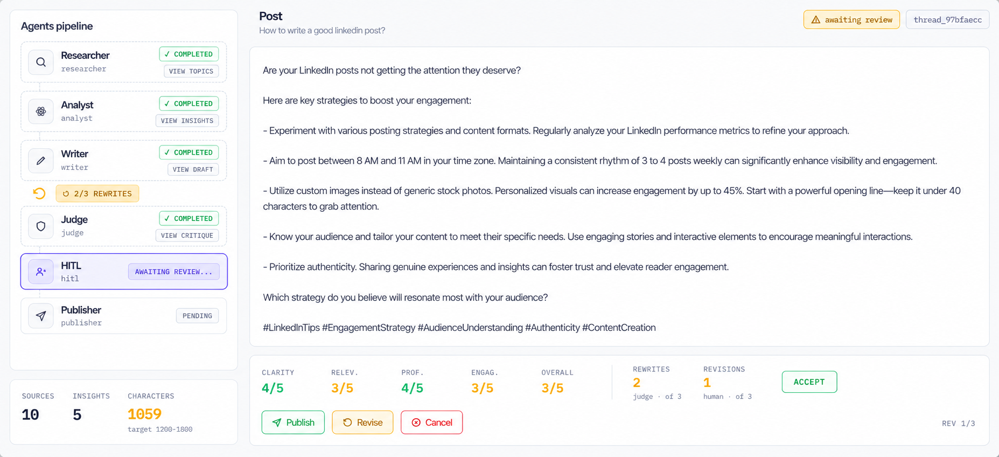
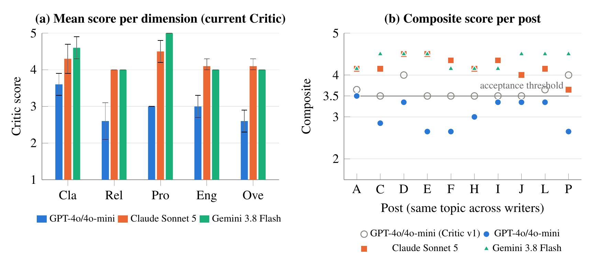

# Human-in-the-Loop Multi-Agent Content Generation

Code, data, and figures accompanying **A Human-in-the-Loop Multi-Agent Architecture for Social Media Content Generation** (ICAART 2027).

Solera writes professional LinkedIn posts with five agents: Researcher, Analyst, Writer, Critic, and Publisher. A stateful LangGraph workflow coordinates them. An LLM-based Critic scores each draft on a four-dimension rubric, an acceptance rule computed in code decides whether the draft is rewritten or forwarded, and a human reviewer approves every post before publication.

The study compares the Critic with 19 human evaluators on ten generated posts. The Critic's scores were close to the mean human ratings but nearly constant across posts, so its exact agreement with individual evaluators (30.9%) did not exceed the level expected from the score distributions (31.2%). The Critic was stable across repeated runs and rejected 80% of truncated posts. A revision of its prompt alone changed 9 of the 10 acceptance decisions.

The figures and tables below follow the order in which they appear in the paper. Figure 1, the pipeline overview, is in the paper.

## Architecture

The Researcher collects sources through web search, the Analyst extracts the main insights, the Writer drafts the post, and the Critic scores it and suggests revisions. The agents are nodes of a LangGraph `StateGraph` and do not call one another: each node reads the shared state and returns a partial update, and conditional edges decide where execution goes next. The Critic never decides whether a post is accepted; that decision is computed in code. A rejected draft returns to the Writer for at most three automatic rewrites. A draft that passes, or exhausts its rewrites, waits for the human reviewer. While it waits, the workflow is suspended with `interrupt()` and its state is persisted, so the run resumes from the same point.

| Agent | Role | Model in the study | Temperature | Prompt (study) |
|---|---|---|---:|---|
| Researcher | Searches recent sources on the topic | GPT-4o | 0.3 | [prompt](prompts/en/01-researcher.md) |
| Analyst | Filters the sources and extracts 3 to 5 insights | GPT-4o | 0.3 | [prompt](prompts/en/02-analyst.md) |
| Writer | Writes the post and the requested rewrites | GPT-4o / GPT-4o-mini | 0.9 | [prompt](prompts/en/03-writer.md) |
| Critic | Scores the post and lists what to improve | GPT-4.1 | 0.1 | [prompt](prompts/en/04-critic.md) |
| Human reviewer | Approves, requests changes, or cancels | | | |
| Publisher | Publishes the approved post on LinkedIn | | | |

The table lists the configuration that produced the study corpus, when the agents called the OpenAI API directly. Since then, all agents call their models through OpenRouter, with the provider pinned per model family. The Writer model is now chosen per run from a catalog (the `llm_models` table, edited on the `/modelos` page): GPT-4.1 (default), Claude Sonnet 5, and Gemini 3.8 Flash. The last two are the Writers of the benchmark. The Researcher and Analyst still default to GPT-4o, and the Critic to GPT-4.1.

The [`prompts/`](prompts/README.md) folder is a frozen record of the prompts the agents received while producing the study corpus (Brazilian Portuguese, generated on 2026-09-14, with [English translations](prompts/en/README.md)). Since 2026-09-18 the prompts live only in the code, in [`src/app/MAS/prompts/`](src/app/MAS/prompts/), and are written in English.

## Human-in-the-Loop checkpoint

After the Critic stage, a human reviewer either approves the post, which forwards it to the Publisher, or returns free-text feedback, which routes it back to the Writer, for at most three revision cycles.

**Figure - Free-text feedback after review, which routes the post back to the Writer.**

The reviewer sees the draft with the Critic's scores and can publish it, cancel the run, or request changes; here the request is to turn the post into a list. In the interface, the Critic appears as Judge.

**Figure - Example of the Human-in-the-Loop interaction and workflow execution.**

The same run after the revision: the Writer and the Critic processed the request before the draft returned to the reviewer. Both screenshots come from an illustrative run, not from the evaluated posts.

## Critic rubric and acceptance rule

**Table - Quality criteria and scoring rubric used by the Critic agent and human evaluators (translated from Brazilian Portuguese).**

| Criterion | Evaluation question | Scoring rubric (1-5) |
|---|---|---|
| Clarity and Readability | Is the post clear, understandable, well structured and easy to read? | **(1) Very poor:** Confusing; dense block or overly long sentences, with no identifiable central idea. **(2) Poor:** Hard to follow; weak structure and requires re-reading; the idea appears only at the end or not at all. **(3) Acceptable:** Understandable with average effort; acceptable structure, but some passages are dense, truncated, or repetitive. **(4) Good:** Clear and well organized; fluent reading, central idea evident early, and line breaks support readability. **(5) Excellent:** Exceptionally clear; each paragraph advances the idea, rhythm and formatting serve the reader, and nothing is superfluous. |
| Relevance and Informational Value | Does the post deliver meaningful, substantive information appropriate for a professional audience, and does it fulfil the intent of the topic? | **(1) Very poor:** No value or off-topic; provides no information and/or does not address the topic's intent. **(2) Poor:** Generic; relies on common sense or broad claims without substance and only marginally addresses the topic. **(3) Acceptable:** Correct but predictable; covers the basics without adding much value for people in the field. **(4) Good:** Substantive; provides a data point, example, or useful distinction and addresses the topic's intent well. **(5) Excellent:** High value; provides a non-obvious, specific, and actionable insight for the professional audience. |
| Professional Appropriateness | Are the tone, language and presentation appropriate for a professional social network and the intended audience? | **(1) Very poor:** Inappropriate; offensive, sensationalist, jarringly informal, or aggressively promotional. **(2) Poor:** Out of place; uses exaggeration, clickbait, empty marketing jargon, excessive emojis, or punctuation. **(3) Acceptable:** Nothing improper, but the register fluctuates or sounds impersonal and generic. **(4) Good:** Appropriate; consistent and authentic professional tone with language suited to the audience. **(5) Excellent:** Exemplary; credible and natural professional voice, calibrated to the audience and free of clichés. |
| Engagement Quality | Does the post attract attention, sustain interest and encourage appropriate professional interaction? | **(1) Very poor:** Does not hold attention; no effective opening or sustained interest, or artificially requests interaction. **(2) Poor:** Weak; slow start and declining interest, with a generic invitation such as 'what do you think?'. **(3) Acceptable:** Average; functional opening and sufficient interest to reach the end, but the invitation is not very specific. **(4) Good:** Attention-grabbing opening, sustained interest, and an invitation anchored in the post's content. **(5) Excellent:** The first line compels continued reading, tension is maintained, and the invitation draws on a specific reader experience. |

Every point of the scale has a verbal anchor. The Critic also gives an unanchored Overall Quality score, which does not enter the acceptance rule. The [original rubric](prompts/05-rubrica-e-regra-de-aceitacao.md) is in Portuguese.

**Acceptance rule.** A post goes to human review when the composite `0.35 Cla + 0.35 Rel + 0.15 Pro + 0.15 Eng` is at least 3.5 and no two dimensions score below 3 with at least one of them being Clarity or Relevance. The rule is computed in code, not by the Critic.

## Evaluation protocol

Ten posts in Brazilian Portuguese, all accepted by the Critic at the first pass, were rated by 19 evaluators on the four rubric questions and Overall Quality (950 ratings). The Critic also re-scored each post five times and once after truncation, and the pipeline was rerun with Claude Sonnet 5 and Gemini 3.8 Flash as the Writer.

**Table - Evaluated posts: requested topic (translated), length in characters, stored Critic scores (Clarity, Relevance, Professional Appropriateness, Engagement, Overall) and mean human score per dimension.**

| Post | Requested topic (translated) | Chars | Critic | Cla | Rel | Pro | Eng | Ov |
|---|---|---:|:---:|---:|---:|---:|---:|---:|
| A | What is technical debt and how can it be explained to non-technical people? | 896 | 4,3,4,4,3 | 4.2 | 3.9 | 4.0 | 3.6 | 3.9 |
| J | Junior programmers will no longer be hired from 2027 onwards | 1361 | 4,3,4,3,3 | 4.2 | 4.3 | 4.2 | 4.2 | 4.2 |
| D | Legacy code that nobody wants to touch and nobody manages to replace | 1867 | 4,4,4,4,4 | 4.0 | 3.9 | 4.2 | 3.8 | 3.8 |
| L | Why do retrospective meetings change nothing? | 1686 | 4,3,5,3,3 | 3.9 | 3.7 | 4.2 | 3.6 | 3.7 |
| F | Technical certifications have lost value in hiring processes | 1227 | 4,3,4,3,3 | 3.8 | 3.6 | 3.9 | 3.8 | 3.8 |
| P | A college degree is no longer of any use in the job market | 1197 | 4,4,4,4,4 | 3.8 | 3.8 | 3.7 | 3.5 | 3.7 |
| I | Artificial intelligence will transform the future of work | 1309 | 4,3,4,3,3 | 3.7 | 3.9 | 3.6 | 3.7 | 3.9 |
| E | How to double a development team's productivity in 30 days? | 938 | 4,3,4,3,3 | 3.9 | 3.5 | 3.9 | 3.4 | 3.6 |
| H | What is the future of programming? | 1555 | 4,3,4,3,3 | 3.7 | 3.5 | 3.7 | 3.5 | 3.6 |
| C | Daily stand-up meetings have become an empty ritual in most tech teams | 1183 | 4,3,4,3,3 | 4.2 | 3.7 | 4.2 | 3.7 | 3.9 |

The Critic gave Clarity a 4 to every post, while the human means ranged from 3.7 to 4.2; six posts sat exactly at the 3.50 acceptance threshold.

Records: [Post texts and metadata](study/data/corpus.csv) · [Critic scores of the rated posts](study/data/critic-scores.csv) · [Questionnaire responses](study/data/form-responses.xlsx) · [Post-letter mapping](study/data/mapping-corpus.csv).

## Critic-human agreement and human reliability

**Table - Exact and within-one (±1) agreement between pairs of human evaluators, between the Critic and human evaluators, and expected by chance for Critic-human comparisons given the observed score distributions.**

| Dimension | H-H exact | H-H ±1 | C-H exact | C-H ±1 | Chance exact | Chance ±1 |
|---|---:|---:|---:|---:|---:|---:|
| Clarity and Readability | 32.5% | 71.5% | 40.0% | 90.0% | 40.0% | 90.0% |
| Relevance and Informational Value | 27.5% | 66.6% | 21.1% | 66.3% | 19.9% | 65.4% |
| Professional Appropriateness | 30.9% | 74.2% | 41.1% | 88.9% | 41.3% | 89.1% |
| Engagement Quality | 25.7% | 64.4% | 21.6% | 66.8% | 23.6% | 67.7% |
| **Four dimensions** | **29.1%** | **69.2%** | **30.9%** | **78.0%** | **31.2%** | **78.0%** |
| 95% CI | 21.7% to 37.3% | 56.3% to 81.3% | 22.3% to 39.9% | 66.8% to 87.7% | | |
| Overall Quality | 27.4% | 67.4% | 22.6% | 67.9% | 23.3% | 67.7% |

Critic-human exact agreement (30.9%) matched the level expected by chance from the score distributions (31.2%), and human-human agreement (29.1%) was also at chance level (29.0%).

**Figure - Distribution of human evaluators' ratings for each post and quality criterion (n = 19).**

Ratings of 4 and 5 dominate every post, and the posts look alike: differences between posts explain 2% to 4% of the variation in human scores, against 41% to 44% for differences between evaluators.

**Table - Score levels and association.**

| Dimension | Human M (SD) | Critic M (SD) | Bias [95% CI] | MAE | κw | ρ | α (humans) |
|---|---:|---:|---:|---:|---:|---:|---:|
| Clarity and Readability | 3.94 (1.10) | 4.00 (0.00) | +0.06 [−0.28, +0.44] | 0.76 | 0.00 | n/a | −0.02 |
| Relevance and Informational Value | 3.79 (1.18) | 3.20 (0.42) | −0.59 [−1.03, −0.13] | 1.14 | 0.02 | 0.22 | −0.01 |
| Professional Appropriateness | 3.96 (1.06) | 4.10 (0.32) | +0.14 [−0.22, +0.52] | 0.75 | 0.04 | 0.47 | 0.00 |
| Engagement Quality | 3.69 (1.23) | 3.30 (0.48) | −0.39 [−0.88, +0.10] | 1.14 | −0.01 | −0.04 | −0.01 |
| Overall Quality | 3.82 (1.12) | 3.20 (0.42) | −0.62 [−1.05, −0.15] | 1.11 | −0.01 | −0.17 | −0.03 |

The Critic's means are close to the human means, but its standard deviations are much smaller; κw near zero and α between −0.03 and 0.00 show little post-level agreement, both for the Critic and among the evaluators.

Records: [Agreement analysis](study/analysis/form_agreement.py) · [Questionnaire responses](study/data/form-responses.xlsx) · [Critic scores](study/data/critic-scores.csv).

## Critic stability and response to degraded posts

Across five repeated runs, the Critic reproduced its stored scores in 86% to 100% of cases and never differed by more than one point; it rejected 80% of the truncated posts.

Records: [Repeated runs and truncation control](study/data/critic-repeat.csv) · [Script that produced them](scripts/study-critic-form.ts).

## Writer comparison and prompt sensitivity

**Figure - Critic scores for the ten topics written by three Writers.**

Under the current Critic prompt, the Claude and Gemini posts stay above the 3.5 threshold on all ten topics. The open circles are the original scores of the GPT posts; the prompt revision alone changed 9 of their 10 acceptance decisions.

**Table - Critic scores per Writer: accepted posts, mean composite with 95% bootstrap interval, and mean per dimension.**

| Writer | Accepted | Composite [95% CI] | Cla | Rel | Pro | Eng | Overall |
|---|---:|---:|---:|---:|---:|---:|---:|
| GPT-4o / GPT-4o-mini (original Critic prompt) | 10/10 | 3.63 [3.53, 3.75] | 4.0 | 3.2 | 4.1 | 3.3 | 3.2 |
| GPT-4o / GPT-4o-mini | 1/10 | 3.07 [2.87, 3.27] | 3.6 | 2.6 | 3.0 | 3.0 | 2.6 |
| Claude Sonnet 5 | 10/10 | 4.20 [4.03, 4.33] | 4.3 | 4.0 | 4.5 | 4.1 | 4.1 |
| Gemini 3.8 Flash | 10/10 | 4.36 [4.25, 4.46] | 4.6 | 4.0 | 5.0 | 4.0 | 4.0 |

The first row uses the original Critic prompt; the others share the current one.

Records: [Benchmark scores](study/data/benchmark-scores.csv) · [Script that scores all three Writers under the same Critic](scripts/study-benchmark.ts).

## Repository guide

| Material | Location |
|---|---|
| Prompts used in the study (frozen record) and English translations | [prompts/](prompts/README.md) |
| Agents, LangGraph workflow, current prompts, tools, and stores | [src/app/MAS/](src/app/MAS/) |
| Web interface (runs, review, models, study panels) | [src/app/(dashboard)/](src/app/%28dashboard%29/) |
| Questionnaire responses, corpus, benchmark, and Critic scores | [study/data/](study/data/README.md) |
| Database schema and migrations | [drizzle/](drizzle/) |
| Figures used in this README | [figures/](figures/) |

## Running locally

Solera is a Next.js application that uses PostgreSQL and calls its models through OpenRouter.

1. Install the dependencies with `pnpm install`.
2. Create a `.env.local` file with the variables below. API keys and LinkedIn credentials can also be set on the `/configuracoes` page.
3. Apply the migrations in [`drizzle/`](drizzle/) to the database.
4. Run `pnpm dev`, open `http://localhost:3000`, and sign in with your LinkedIn account.

| Variable | Purpose |
|---|---|
| `DATABASE_URL` | PostgreSQL connection |
| `OPENROUTER_API_KEY` | Model access for all agents |
| `TAVILY_API_KEY` or `BRAVE_API_KEY` | Web search for the Researcher (`BRAVE_URL` optionally overrides the Brave endpoint) |
| `DEFAULT_NAVIGATOR` | Default search provider: `tavily` or `brave` |
| `LINKEDIN_CLIENT_ID`, `LINKEDIN_CLIENT_SECRET`, `LINKEDIN_REDIRECT_URI` | LinkedIn sign-in and publishing |
| `SESSION_SECRET` | Signs the login session |
| `ALLOWED_LINKEDIN_EMAILS` | Optional: comma-separated LinkedIn emails allowed to sign in (empty allows everyone) |
| `ADMIN_LINKEDIN_IDS` | Optional: LinkedIn IDs that keep access even when deactivated |
| `LANGCHAIN_API_KEY` | Optional: run tracing in LangSmith |
| `OWNER_ID` | Identifies the owner of the runs in the study scripts |

| Command | What it does |
|---|---|
| `pnpm study:critic-form` | Exports the Critic scores of the rated posts |
| `pnpm study:benchmark` | Scores the posts of the three Writers under the same Critic |
| `python study/analysis/form_agreement.py` | Reruns the analysis and the paper tables |
