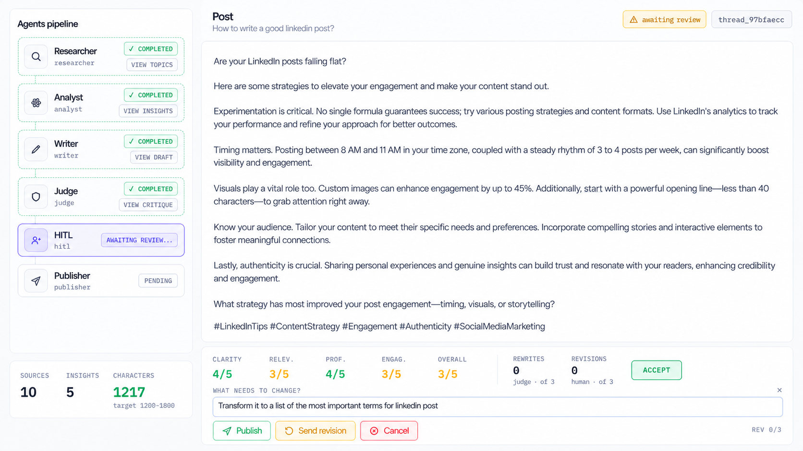
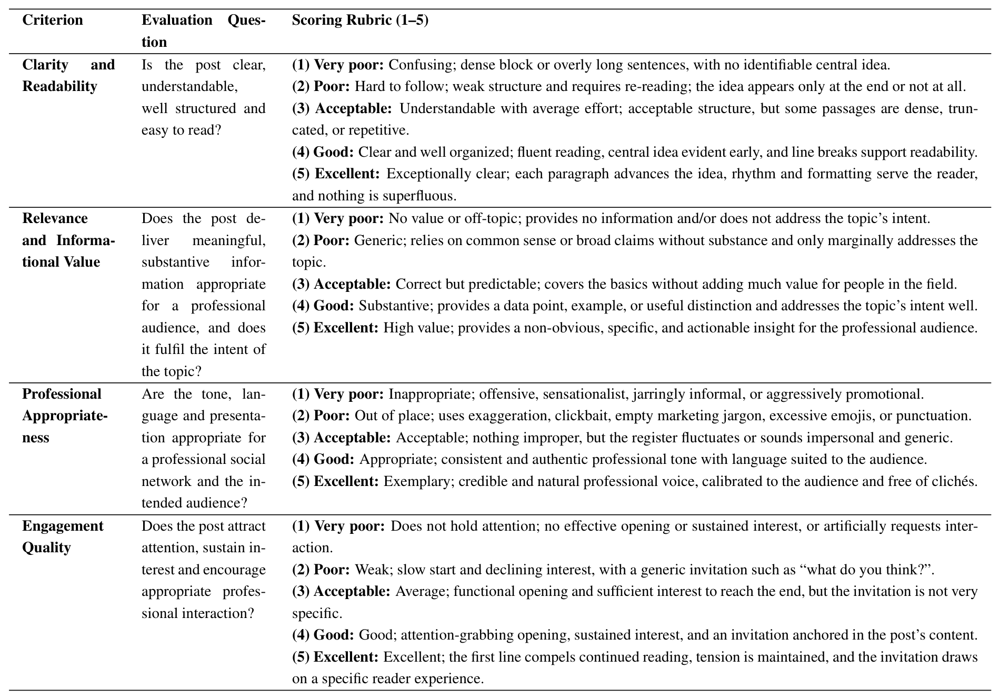
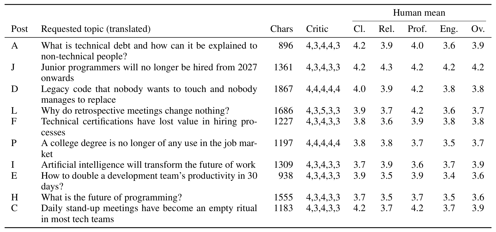
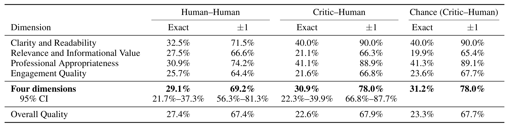
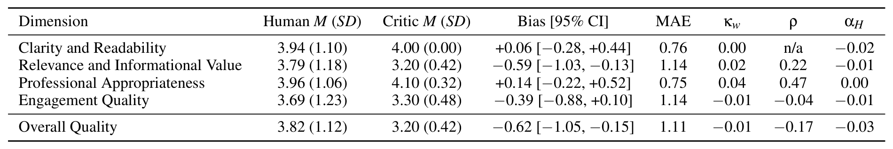
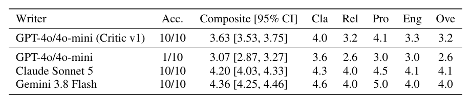

# Human-in-the-Loop Multi-Agent Content Generation

This repository holds the implementation of the multi-agent system presented in the ICAART 2027 paper **A Human-in-the-Loop Multi-Agent Architecture for Social Media Content Generation**, together with the prompts and evaluation data used in the study and the figures and tables the paper refers to.

The system produces professional LinkedIn posts through five specialized agents (Researcher, Analyst, Writer, Critic, and Publisher) coordinated by a stateful LangGraph workflow. Each draft is scored by an LLM-based Critic on a four-dimension rubric; a rule computed in code then sends it back to the Writer or forward to a human reviewer, who approves every post before it is published.

The study compares the Critic with 19 human evaluators on ten generated posts. The Critic's scores were close to the mean human ratings but nearly constant across posts, so its exact agreement with individual evaluators (30.9%) did not exceed the level expected from the score distributions (31.2%). The Critic was stable across repeated runs and rejected 80% of truncated posts. A revision of its prompt alone changed 9 of the 10 acceptance decisions.

The figures and tables below follow the order in which they appear in the paper. Figure 1, the pipeline overview, is in the paper.

## Contents

1. [Architecture](#architecture)
2. [Implementation](#implementation)
3. [Human-in-the-Loop checkpoint](#human-in-the-loop-checkpoint)
4. [Critic rubric and acceptance rule](#critic-rubric-and-acceptance-rule)
5. [Evaluation protocol](#evaluation-protocol)
6. [Critic-human agreement and human reliability](#critic-human-agreement-and-human-reliability)
7. [Critic stability and response to degraded posts](#critic-stability-and-response-to-degraded-posts)
8. [Writer comparison and prompt sensitivity](#writer-comparison-and-prompt-sensitivity)
9. [Repository guide](#repository-guide)
10. [Running locally](#running-locally)

## Architecture

The Researcher collects sources through web search, the Analyst extracts the main insights, the Writer drafts the post, and the Critic scores it and suggests revisions. The agents are nodes of a LangGraph `StateGraph` and do not call one another: each node reads the shared state and returns a partial update, and conditional edges decide where execution goes next. The Critic never decides whether a post is accepted; that decision is computed in code. A rejected draft returns to the Writer for at most three automatic rewrites. A draft that passes, or exhausts its rewrites, waits for the human reviewer. While it waits, the workflow is suspended with `interrupt()` and its state is persisted, so the run resumes from the same point.

| Agent | Role | Model in the study | Temperature | Prompt (study) |
|---|---|---|---:|---|
| Researcher | Searches recent sources on the topic | GPT-4o | 0.3 | [prompt](prompts/en/01-researcher.md) |
| Analyst | Filters the sources and extracts 3 to 5 insights | GPT-4o | 0.3 | [prompt](prompts/en/02-analyst.md) |
| Writer | Writes the post and the requested rewrites | GPT-4o / GPT-4o-mini | 0.9 | [prompt](prompts/en/03-writer.md) |
| Critic | Scores the post and lists what to improve | GPT-4.1 | 0.1 | [prompt](prompts/en/04-critic.md) |
| Human reviewer | Approves, requests changes, or cancels | | | |
| Publisher | Publishes the approved post on LinkedIn | | | |

The table lists the configuration that produced the study corpus, when the agents called the OpenAI API directly. Since then, all agents call their models through OpenRouter, with the provider pinned per model family. The Writer model is now chosen per run from a catalog (the `llm_models` table, edited on the `/modelos` page): GPT-4.1 (default), Claude Sonnet 5, and Gemini 3.8 Flash. The last two are the Writers of the benchmark. The Researcher and Analyst still default to GPT-4o, and the Critic to GPT-4.1.

The [`prompts/`](prompts/README.md) folder is a frozen record of the prompts the agents received while producing the study corpus (Brazilian Portuguese, generated on 2026-09-14, with [English translations](prompts/en/README.md)). Since 2026-09-18 the prompts live only in the code, in [`src/app/MAS/prompts/`](src/app/MAS/prompts/), and are written in English.

## Implementation

The system is implemented in TypeScript with LangGraph.js. The workflow is a `StateGraph` over a shared `AgentState`, and conditional edges implement the acceptance rule and the human decision. Graph checkpoints are persisted by a file-backed extension of LangGraph's in-memory checkpointer, so interrupted runs survive server restarts. Every draft version and Critic assessment is stored in PostgreSQL with its provenance (Critic model, temperature, rubric version and a hash of the Critic prompt), so that scores from different Critic configurations cannot be mixed unnoticed. A Next.js interface starts and resumes runs, streams progress through Server-Sent Events, and lets the reviewer approve a post or send feedback.

The Researcher and Analyst agents use GPT-4o at temperature 0.3 and the Critic uses GPT-4.1 at temperature 0.1. The Writer agent runs at temperature 0.9; it was a GPT-4o-family model for the human-rated posts and Claude Sonnet 5 or Gemini 3.8 Flash in the Writer benchmark. The Critic model differs from every Writer model to reduce self-preference bias (Panickssery et al., 2024), although the GPT-4o Writers share its model family. The Researcher queries the Tavily search API and the Publisher uses the LinkedIn REST API.

## Human-in-the-Loop checkpoint

After the Critic stage, a human reviewer either approves the post, which forwards it to the Publisher, or returns free-text feedback, which routes it back to the Writer, for at most three revision cycles.

**Figure - Free-text feedback after review, which routes the post back to the Writer.**

The reviewer sees the draft with the Critic's scores and can publish it, cancel the run, or request changes; here the request is to turn the post into a list. In the interface, the Critic appears as Judge.

**Figure - Example of the Human-in-the-Loop interaction and workflow execution.**

The same run after the revision: the Writer and the Critic processed the request before the draft returned to the reviewer. Both screenshots come from an illustrative run, not from the evaluated posts.

## Critic rubric and acceptance rule

**Table - Quality criteria and scoring rubric used by the Critic agent and human evaluators (translated from Brazilian Portuguese).**

Every point of the scale has a verbal anchor. The Critic also gives an unanchored Overall Quality score, which does not enter the acceptance rule.

**Acceptance rule.** A post goes to human review when the composite `0.35 Cla + 0.35 Rel + 0.15 Pro + 0.15 Eng` is at least 3.5 and no two dimensions score below 3 with at least one of them being Clarity or Relevance. The rule is computed in code, not by the Critic.

## Evaluation protocol

Ten posts in Brazilian Portuguese, all accepted by the Critic at the first pass, were rated by 19 evaluators on the four rubric questions and Overall Quality (950 ratings). The Critic also re-scored each post five times and once after truncation, and the pipeline was rerun with Claude Sonnet 5 and Gemini 3.8 Flash as the Writer.

**Table - Evaluated posts: requested topic (translated), length in characters, stored Critic scores (Clarity, Relevance, Professional Appropriateness, Engagement, Overall) and mean human score per dimension.**

The Critic gave Clarity a 4 to every post, while the human means ranged from 3.7 to 4.2; six posts sat exactly at the 3.50 acceptance threshold.

## Critic-human agreement and human reliability

**Table - Exact and within-one (±1) agreement between pairs of human evaluators, between the Critic and human evaluators, and expected by chance for Critic-human comparisons given the observed score distributions.**

Critic-human exact agreement (30.9%) matched the level expected by chance from the score distributions (31.2%), and human-human agreement (29.1%) was also at chance level (29.0%).

**Figure - Distribution of human evaluators' ratings for each post and quality criterion (n = 19).**

Ratings of 4 and 5 dominate every post, and the posts look alike: differences between posts explain 2% to 4% of the variation in human scores, against 41% to 44% for differences between evaluators.

**Table - Score levels and association.**

The Critic's means are close to the human means, but its standard deviations are much smaller; κw near zero and α between −0.03 and 0.00 show little post-level agreement, both for the Critic and among the evaluators.

## Writer comparison and prompt sensitivity

**Figure - Critic scores for the ten topics written by three Writers.**

Under the current Critic prompt, the Claude and Gemini posts stay above the 3.5 threshold on all ten topics. The open circles are the original scores of the GPT posts; the prompt revision alone changed 9 of their 10 acceptance decisions.

**Table - Critic scores per Writer: accepted posts, mean composite with 95% bootstrap interval, and mean per dimension.**

The first row uses the original Critic prompt; the others share the current one.

## Repository guide

| Material | Location |
|---|---|
| Prompts used in the study (frozen record) and English translations | [prompts/](prompts/README.md) |
| Agents, LangGraph workflow, current prompts, tools, and stores | [src/app/MAS/](src/app/MAS/) |
| Web interface (runs, review, models, study panels) | [src/app/(dashboard)/](src/app/%28dashboard%29/) |
| Questionnaire responses, corpus, benchmark, and Critic scores | [study/data/](study/data/README.md) |
| Database schema and migrations | [drizzle/](drizzle/) |
| Figures used in this README | [figures/](figures/) |

## Running locally

The application is built with Next.js, stores its data in PostgreSQL, and calls its models through OpenRouter.

1. Install the dependencies with `pnpm install`.
2. Create a `.env.local` file with the variables below. API keys and LinkedIn credentials can also be set on the `/configuracoes` page.
3. Apply the migrations in [`drizzle/`](drizzle/) to the database.
4. Run `pnpm dev`, open `http://localhost:3000`, and sign in with your LinkedIn account.

| Variable | Purpose |
|---|---|
| `DATABASE_URL` | PostgreSQL connection |
| `OPENROUTER_API_KEY` | Model access for all agents |
| `TAVILY_API_KEY` or `BRAVE_API_KEY` | Web search for the Researcher (`BRAVE_URL` optionally overrides the Brave endpoint) |
| `DEFAULT_NAVIGATOR` | Default search provider: `tavily` or `brave` |
| `LINKEDIN_CLIENT_ID`, `LINKEDIN_CLIENT_SECRET`, `LINKEDIN_REDIRECT_URI` | LinkedIn sign-in and publishing |
| `SESSION_SECRET` | Signs the login session |
| `ALLOWED_LINKEDIN_EMAILS` | Optional: comma-separated LinkedIn emails allowed to sign in (empty allows everyone) |
| `ADMIN_LINKEDIN_IDS` | Optional: LinkedIn IDs that keep access even when deactivated |
| `LANGCHAIN_API_KEY` | Optional: run tracing in LangSmith |
| `OWNER_ID` | Identifies the owner of the runs in the study scripts |

| Command | What it does |
|---|---|
| `pnpm study:critic-form` | Exports the Critic scores of the rated posts |
| `pnpm study:benchmark` | Scores the posts of the three Writers under the same Critic |
| `python study/analysis/form_agreement.py` | Reruns the analysis and the paper tables |
